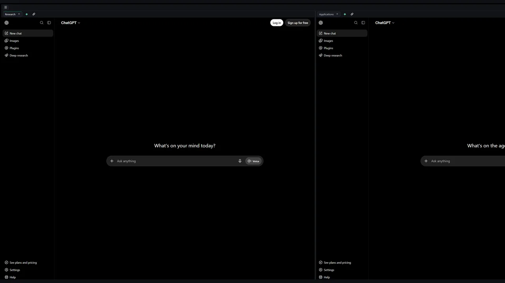

# ChatDeck

**Your ChatGPT and Claude conversations, arranged like a workspace.** ChatDeck is a fast
desktop app that turns both into one multi-pane, multi-tab working surface: compare answers
side by side, keep projects in separate tab groups, and open terminal tabs next to your chats.

> ChatDeck works with ChatGPT and Claude and needs your own account with whichever you use.
> It is not affiliated with, endorsed by, or sponsored by OpenAI or Anthropic.

This repository holds ChatDeck's **releases only**. The source code is not public.

## Download

Get the newest version from the [download page](https://ermischo.github.io/chatdeck-releases/)
or from [Releases](https://github.com/ErmisCho/chatdeck-releases/releases/latest).

### Windows 10/11

Run `ChatDeck-windows-setup.exe`. It installs for you alone, needs no administrator rights,
and updates itself from Settings. The installer is not code-signed yet, so Windows may say
**"Windows protected your PC"**: choose **More info → Run anyway**.

### macOS (Apple Silicon and Intel)

Open `ChatDeck-mac.dmg` and drag ChatDeck to Applications. The app is not notarized yet, so
the first launch is blocked: open **System Settings → Privacy & Security** and choose
**Open Anyway**. If macOS instead says the app "is damaged", run
`xattr -dr com.apple.quarantine /Applications/ChatDeck.app` in Terminal once. Mac updates are
manual for now: download the new dmg.

## About

Made by Ermis Chorinopoulos. Open to new roles: [LinkedIn](https://www.linkedin.com/in/ermischo/).
